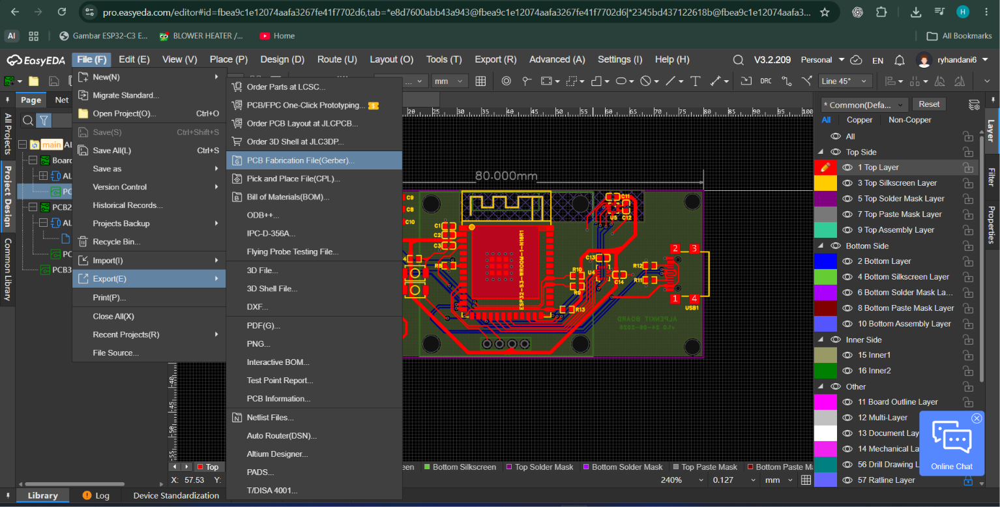

First thing first, siapkan file gerber dan excellon dari Desain PCB yang sudah dibuat. 
Jika menggunakan EasyEDA, file gerber tersebut bisa dilakukan dengan cara:
1. Buka Folder Project PCB yang kita buat di EASYEDA
2. Klik Menu File -> Export -> PCB Fabrication File (Gerber) -> Beri nama pada file gerber tersebut, kemudian Klik 'Export Gerber'

3. Akan ada 2 pilihan, "Yes, Check DRC" atau "No Continue Exporting". Pilih "Yes, Check DRC" jika kamu belum yakin apakah PCB yang kamu buat sudah tidak ada error. Pilih "No, Continue Exporting" jika sudah yakin.
4. Extract File .ZIP yang sudah didownload
5. Selesai

